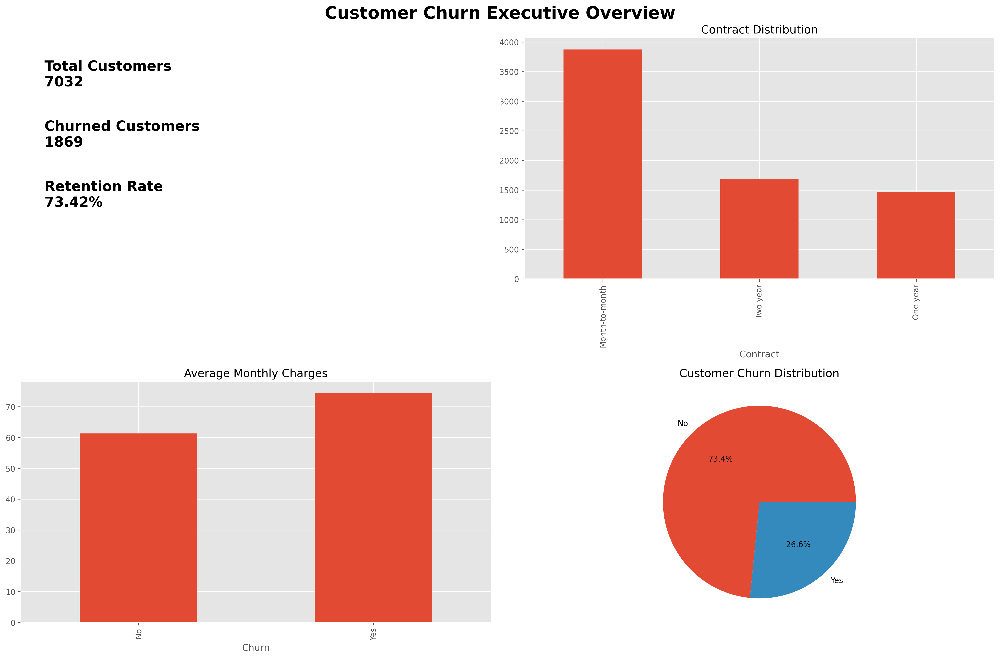
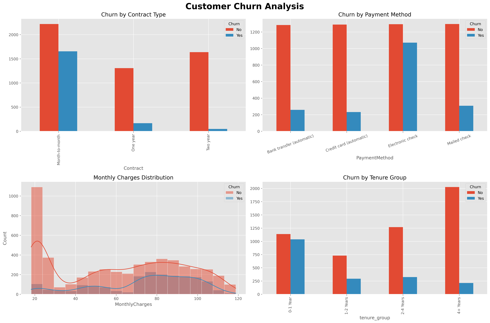
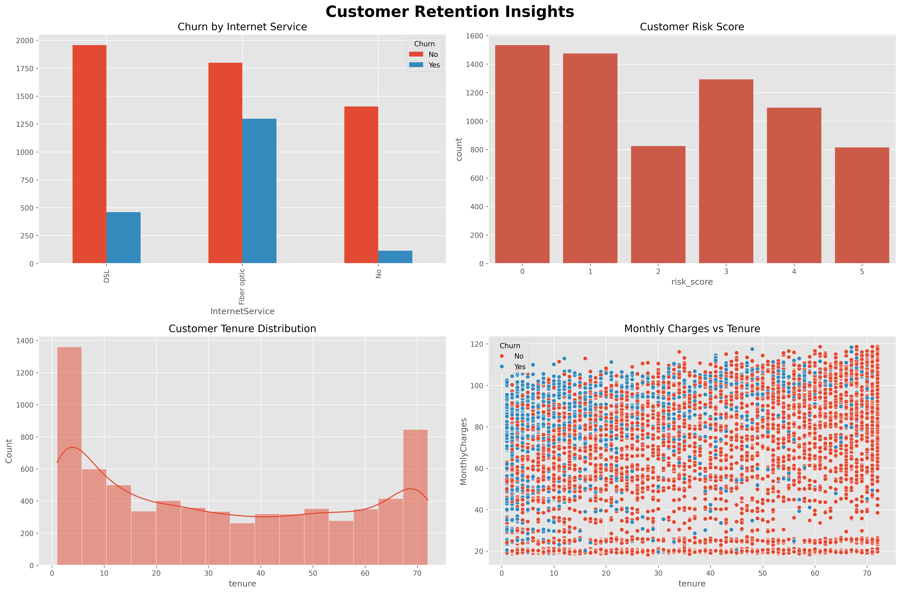

# Customer Churn & Retention Analysis

*A case study on the Telco Customer Churn dataset: who leaves, what it costs, and who retention should call first.*

## The situation

**1,869 of 7,032 customers churned (26.6%).** Churners pay more than the customers who stay: $74.4 a month on average against $61.3, so they take 30.5% of monthly revenue with them.

The question for this project: which customers are most likely to leave, and where should retention effort go?

## What I found

Churn rate by group (each block is about 2 percentage points):

**By contract**
```text
Month-to-month  █████████████████████    42.7%  (3,875 customers)
One year        ██████                   11.3%  (1,472 customers)
Two year        █                         2.8%  (1,685 customers)
```

**By tenure**
```text
0 to 1 year   ████████████████████████ 47.7%  (2,175 customers)
1 to 2 years  ██████████████           28.7%  (1,024 customers)
2 to 4 years  ██████████               20.4%  (1,594 customers)
4+ years      █████                     9.5%  (2,239 customers)
```

**By monthly charges**
```text
Low (under 35)        █████                    10.9%  (1,725 customers)
Medium (35 to 69.95)  ████████████             23.7%  (1,718 customers)
High (70 and above)   ██████████████████       35.5%  (3,589 customers)
```

**By payment method**
```text
Electronic check           ███████████████████████  45.3%  (2,365 customers)
Mailed check               ██████████               19.2%  (1,604 customers)
Bank transfer (automatic)  ████████                 16.7%  (1,542 customers)
Credit card (automatic)    ████████                 15.3%  (1,521 customers)
```

Three groups stand out, because they hold far more churners than their size suggests:

| Group | Share of customers | Share of all churners |
| --- | ---: | ---: |
| Month-to-month contract | 55.1% | 88.6% |
| Electronic check payers | 33.6% | 57.3% |
| First year of tenure | 30.9% | 55.5% |

## Who to call first

The cleaned data carries a churn **risk score from 0 to 5**. Churn rate by score:

```text
0  █                         2.9%  (1,533 customers)
1  ████                     10.9%  (1,474 customers)
2  █████                    16.0%  (824 customers)
3  ██████████████           41.8%  (1,293 customers)
4  █████████████            38.8%  (1,094 customers)
5  ███████████████████████  69.5%  (814 customers)
```

- A score of **5** is exactly the group of month-to-month customers paying over 70 a month with under 12 months of tenure: 814 customers (11.6% of the base) who churn at 69.5%. They account for 30.3% of all churners.
- Scores **3 to 5** cover 45.5% of customers and 81.9% of churners, so a campaign aimed there reaches most of the churn with fewer than half the customers.

## What I would recommend

1. **Move month-to-month customers onto longer contracts** with an incentive. Two-year customers churn at 2.8%.
2. **Invest in the first year.** Nearly half of the first-year customers leave, so onboarding and early check-ins matter most.
3. **Review electronic-check billing.** It churns at roughly three times the rate of automatic payment (45.3% against 15 to 17%), so moving customers to automatic payment is worth testing.
4. **Aim retention offers at risk score 3 and above**, starting with score 5.

These are readings of the correlations in the data, not proof of cause.

## Dashboard

Three pages drawn in Python (matplotlib):

| Executive overview | Churn analysis | Retention insights |
| --- | --- | --- |
|  |  |  |

## How it was done

| Step | Where |
| --- | --- |
| Cleaning: 11 of 7,043 raw rows have a blank `TotalCharges` and are dropped (7,032 left), then tenure and charge groups and a binary churn flag are added | [`notebooks/01_churn_data_cleaning.ipynb`](notebooks/01_churn_data_cleaning.ipynb), [`docs/data_dictionary.md`](docs/data_dictionary.md) |
| SQL: cleaning checks, segmentation, churn analysis, retention metrics, business questions | [`sql/`](sql/) (5 scripts, MySQL syntax, table `customer_churn`) |
| DAX: 11 measures for a Power BI model such as churn rate, retention rate and churned revenue (no Power BI file in this repo) | [`docs/dax_measures.md`](docs/dax_measures.md) |

<details>
<summary>Run the notebook and see the folder layout</summary>

```sh
pip install -r requirements.txt
jupyter notebook notebooks/01_churn_data_cleaning.ipynb
```

```text
.
├── datasets/        raw data, cleaned data, churn summary with risk score, retention metrics
├── sql/             5 scripts
├── notebooks/       01_churn_data_cleaning.ipynb
├── dashboard/       the 3 dashboard images
├── docs/            data dictionary, business insights, DAX measures
└── requirements.txt
```

</details>

---
Dinesh Kumar Gudiputi, [LinkedIn](https://www.linkedin.com/in/dineshkumargudiputi/), [GitHub](https://github.com/dinesh-kumar-gudiputi)
