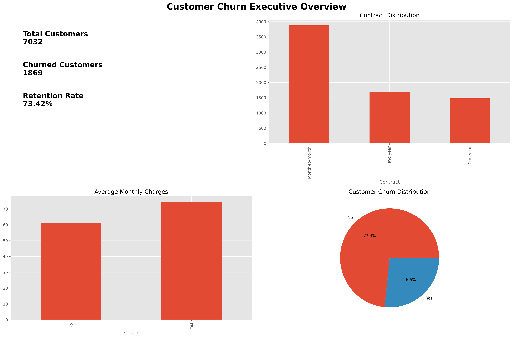
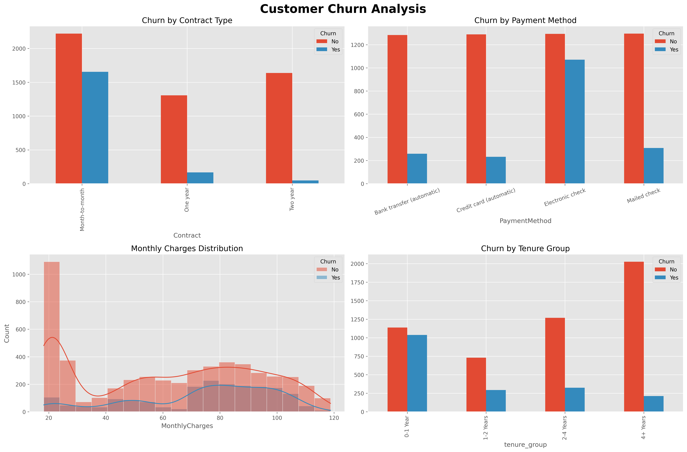
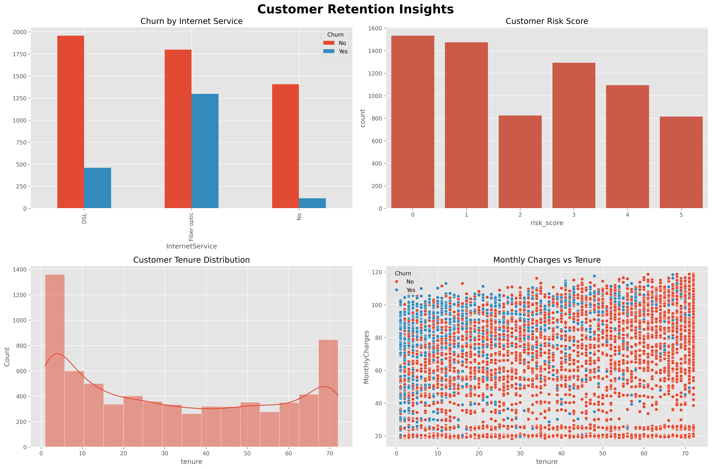

# Customer Churn & Retention Dashboard

## Dashboard Overview

This dashboard project focuses on customer churn analysis and retention insights using SQL, Python, and dashboard reporting workflows.

The dashboard helps analyze:
- customer churn behavior
- retention trends
- contract performance
- customer segmentation
- churn risk indicators
- business KPIs

---

## Dashboard Pages

### 1. Executive Overview
High-level customer churn KPIs and contract distribution analysis.

### 2. Churn Analysis
Analysis of churn behavior across contracts, payment methods, tenure groups, and monthly charges.

### 3. Retention Insights
Customer retention analysis, churn risk scoring, and retention opportunity analysis.

---

## Key KPIs

- Total Customers
- Churned Customers
- Retention Rate
- Churn Rate
- Average Monthly Charges
- Customer Lifetime Metrics

---

## Dashboard Features

- KPI reporting
- Customer segmentation
- Churn risk analysis
- Retention insights
- Business intelligence reporting
- Executive-style dashboard visuals

---

## Dashboard Screenshots

### Executive Overview

---

### Churn Analysis

---

### Retention Insights

